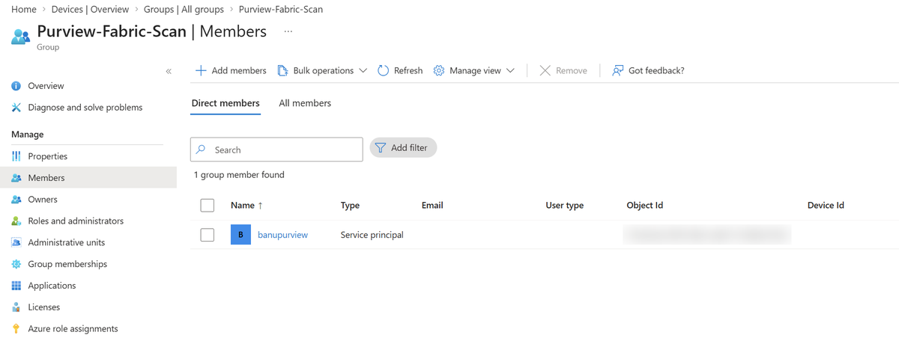
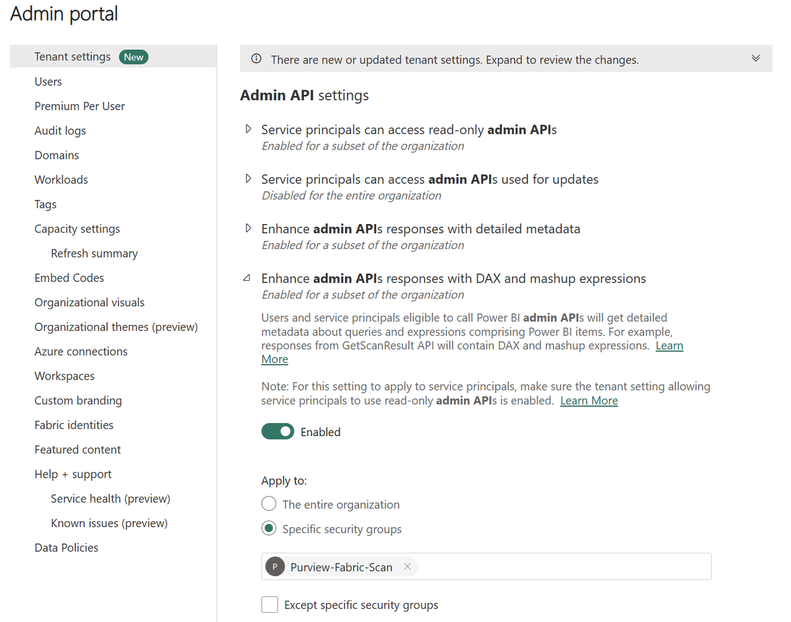
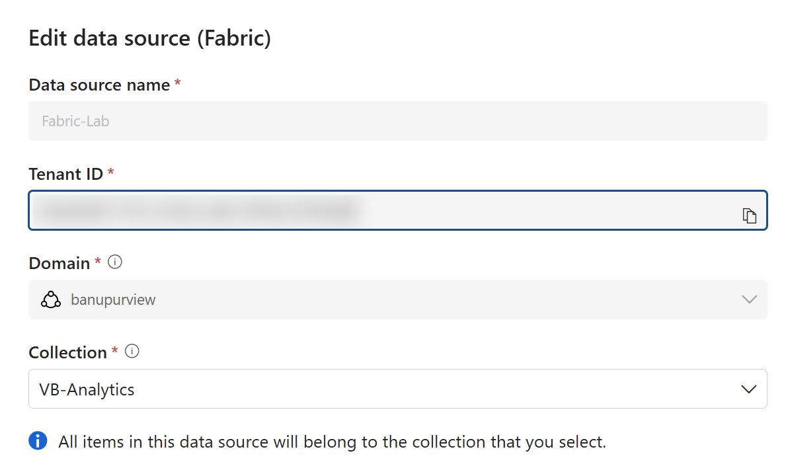
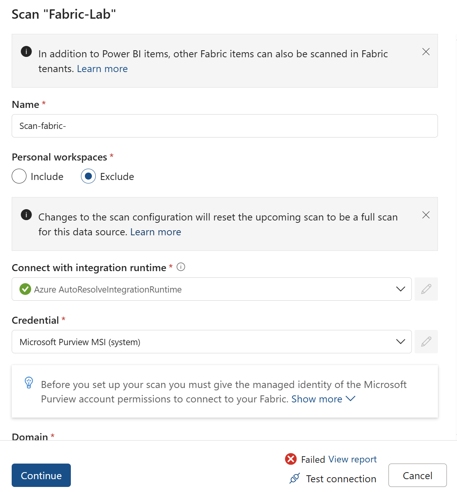
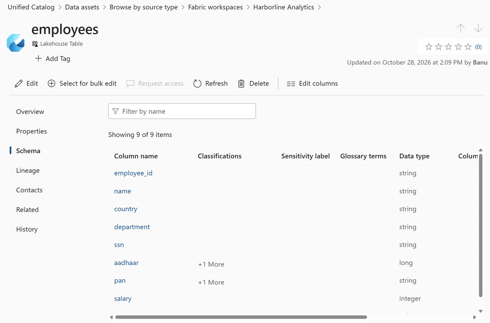

Your data team builds in Fabric. Your governance team works in Purview. Out of the box, Purview knows nothing about your workspaces, lakehouses or tables. Connecting the two takes four places and about fifteen minutes, and one of the steps fails the first time for almost everyone.

## What you need

- A Purview account and a Fabric tenant in the **same** Microsoft tenant.
- Rights to create a security group in Entra, change Fabric tenant settings (Fabric admin), and register sources in Purview (Data Source Administrator on a collection).
- A Fabric capacity that is **running**. A paused capacity means Purview can't reach your lakehouses.

## Step 1: a security group with Purview in it

Purview has a managed identity with the same name as your Purview account. Mine is `banupurview`. Fabric will grant API access to a group, so the group needs Purview inside it.

Entra admin center → **Groups** → **New group**:

- Group type: **Security**
- Name: `Purview-Fabric-Scan`
- Members: search your Purview account's name, add it, Create.

Open the group and look at the member list. Purview shows up as **Type: Service principal**. That's expected; a managed identity is a service principal Azure manages for you. No password, no secret to rotate.

## Step 2: three settings in the Fabric admin portal

Fabric → Settings → **Admin portal** → **Tenant settings**. Search for `admin api`. Enable each of these for **specific security groups** and pick `Purview-Fabric-Scan`:

| Setting | Why Purview needs it |
|---|---|
| Service principals can access read-only admin APIs | Lets Purview list your workspaces and items |
| Enhance admin APIs responses with detailed metadata | Adds tables, columns and data types |
| Enhance admin APIs responses with DAX and mashup expressions | Adds the measures and queries behind reports and dataflows |

Leave **Service principals can access admin APIs used for updates** off. That's write access, and Purview only reads.

One thing to know: the first setting lets that group read the names, owners and descriptions of everything in your Fabric tenant. Once that list is in Purview, Purview's permissions decide who can see it, not Fabric's. Keep the group small.

## Step 3: register Fabric in Purview

Purview → **Data Map** → **Data sources** → **Register** → **Fabric**.

- Name: `Fabric-Lab` (no spaces)
- Domain and collection: pick or create one. I made a collection called `VB-Analytics` to keep Fabric assets together.

Purview finds your Fabric tenant on its own because it's the same Microsoft tenant. There's nothing to point it at.

*Purview fills in the tenant ID itself.*

## Step 4: the scan

Open the new source → **New scan**:

- Name: `Scan-Fabric`
- Personal workspaces: **Exclude**
- Integration runtime: **Azure AutoResolve**
- Credential: **Microsoft Purview MSI (system)**, the managed identity from step 1

Now click **Test connection**.

<strong>This is the step that trips everyone up.</strong> In my lab it failed at 11:29 and passed at 11:30 with nothing changed. Fabric tenant settings take a few minutes to take effect. If the test fails right after step 2, wait ten minutes and try again before you touch anything.

The test checks three things separately (access, assets and lineage, detailed metadata), and each one maps to a setting in step 2. If one still fails after waiting, that tells you which setting to go back to.

When it passes: Continue → Scope your scan: **No** → Trigger: **Once** → **Save and run**.

*Mine, one minute after changing the Fabric settings. A minute later it passed.*

## What Purview found

My scan took a few minutes. Then: **Unified Catalog** → **Data assets** → browse by source type → **Fabric workspaces**. My workspace, my lakehouse, and inside it the `employees` table with all nine columns, their data types and a row count of 40.

Two things worth knowing about what you're looking at:

- **It's metadata only.** Column names, types and row counts. Purview did not read the rows, and it does not classify sensitive data inside Fabric tables the way it does for Azure Storage. If you need PII flagged in a lakehouse, that's a separate topic.
- **"Completed with exceptions" is usually fine.** Mine said that. The log showed *Forbidden* on the **Files** area of lakehouses where Purview had no data access. The tables came through anyway.

## Test it yourself

- [ ] Security group in Entra with your Purview account's managed identity as a member
- [ ] Three admin API settings enabled for that group; the "updates" one left off
- [ ] Fabric registered in the Data Map under a collection
- [ ] Scan created with the Purview MSI credential, personal workspaces excluded
- [ ] Test connection passed (after waiting, if needed)
- [ ] Capacity running during the scan
- [ ] A lakehouse table visible in the Unified Catalog with its columns

Microsoft's reference for the same steps: [Register and scan a Fabric tenant](https://learn.microsoft.com/en-gb/purview/register-scan-fabric-tenant).
